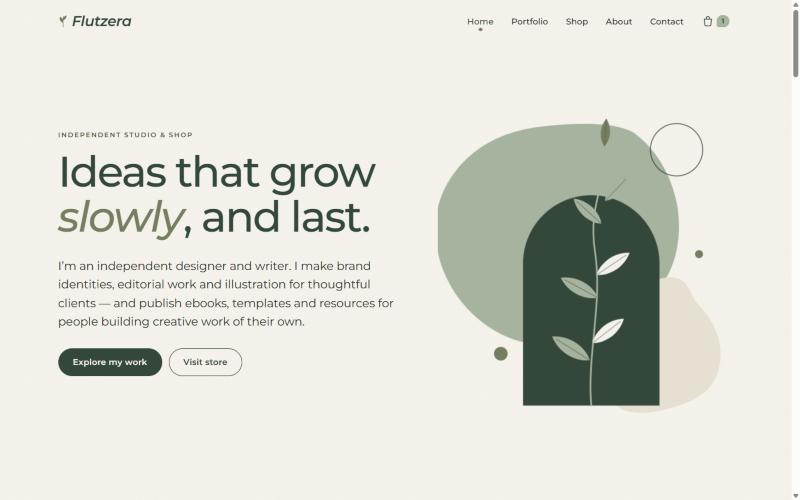
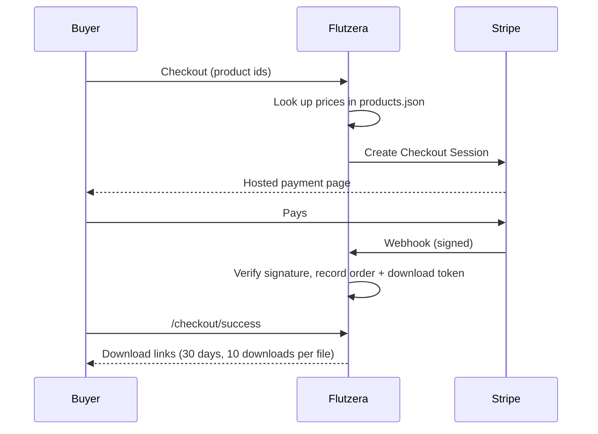

<div align="center">

# 🌿 Flutzera

**An independent studio & shop: a creative portfolio and a digital product store under one calm, organic brand.**




</div>

---

## ✨ What it is

Flutzera is a personal brand website for an independent creator. It does two jobs:

- **Portfolio**: show projects, skills and personal work, like an independent creative studio would.
- **Shop**: sell ebooks, templates, guides and resources, with real checkout and secure file delivery.

The design language is **botanical biomorphic**: soft asymmetric shapes, leaf curves, paper grain and lots of whitespace. All illustrations and product covers are drawn in code from the brand palette, so there are no images to manage.

## 🌱 Features

| | |
|---|---|
| 🎨 **Portfolio** | Asymmetric project grid, category filters, a detail page for each project with a "next project" link |
| 🛍️ **Shop** | Category filters, live search, sorting, product pages with "what's included", product info and related products |
| 🛒 **Cart** | Stored in the browser; prices are always taken from the server, never from the browser |
| 💳 **Checkout** | Stripe Checkout (hosted page); stays closed and says so until keys are set, so it never fakes a purchase |
| 📦 **Delivery** | The order is recorded only after a verified Stripe webhook; download links expire after 30 days, with up to 10 downloads per file |
| ✉️ **Contact** | Validated form with spam honeypot; works without JavaScript |
| 📰 **Newsletter** | Sends sign-ups to Buttondown, or saves them to a local file |
| 🔎 **SEO** | Server-rendered HTML, meta and Open Graph tags, JSON-LD for products, `sitemap.xml`, `robots.txt` |
| ♿ **Accessibility** | Skip link, visible focus, readable contrast, live status messages; motion turns off when the visitor's device asks for reduced motion |
| 📱 **Responsive** | Desktop, tablet and mobile layouts, with a mobile menu |

## 🚀 Quick start

```bash
git clone https://github.com/SakshamJEE/Flutzera.git
cd Flutzera
npm start
```

Open **http://localhost:3000**. There is nothing to install: the project has zero npm dependencies.

```bash
npm run dev    # restart on file changes
npm test       # commerce logic tests
```

## 🗂️ Project structure

```
Flutzera/
├── server.js              # HTTP server, routing, API endpoints
├── lib/
│   ├── views.js           # Server-rendered pages + botanical SVG art
│   └── commerce.js        # Cart pricing, Stripe signature check, download rules
├── public/
│   ├── styles.css         # Design system: tokens, layout, motion
│   └── app.js             # Menu, filters, cart, forms, reveal & parallax
├── content/               # ✏️ Edit these to manage the site
│   ├── site.json
│   ├── products.json
│   └── projects.json
├── private/downloads/     # Product files (git-ignored, never served directly)
├── data/                  # Orders, messages, subscribers (git-ignored)
└── test/
```

## ✏️ Managing content

Everything lives in plain JSON in `content/`. Edits show up on the next page load, without a restart.

<details>
<summary><b>Add a product</b></summary>

```json
{
  "id": "my-new-guide",
  "slug": "my-new-guide",
  "title": "My New Guide",
  "category": "guides",
  "price": 1500,
  "tone": "sage",
  "featured": false,
  "summary": "One line that sells it.",
  "description": ["Paragraph one.", "Paragraph two."],
  "includes": ["40-page PDF", "Worksheet"],
  "info": { "Format": "PDF", "Length": "40 pages" },
  "file": "my-new-guide.zip"
}
```

- `price` is in **cents** (`1500` = $15.00).
- `category` is one of `ebooks`, `templates`, `guides`, `resources` or `future`.
- `tone` sets the cover colour: `forest`, `sage`, `beige`, `olive` or `charcoal`.
- `"status": "coming-soon"` shows the product with a newsletter sign-up instead of a buy button.
- Put the file itself at `private/downloads/my-new-guide.zip`.

</details>

<details>
<summary><b>Add a portfolio project</b></summary>

```json
{
  "slug": "new-project",
  "title": "New Project",
  "category": "Brand Identity",
  "year": 2026,
  "client": "Client name",
  "role": "Identity, art direction",
  "tone": "forest",
  "variant": 2,
  "featured": true,
  "summary": "Short description for cards.",
  "sections": [{ "heading": "The brief", "text": "..." }]
}
```

- `variant` (0–3) picks the illustration.
- `featured: true` shows the project on the home page.

</details>

## 💳 Payments & delivery



**Setup**

1. `cp .env.example .env`
2. Set `STRIPE_SECRET_KEY` (start with `sk_test_…`).
3. Add a Stripe webhook pointing to `https://your-domain/api/stripe-webhook` for `checkout.session.completed` and `checkout.session.async_payment_succeeded`. Put its signing secret in `STRIPE_WEBHOOK_SECRET`.
4. For local testing, forward webhooks with the Stripe CLI:
   ```bash
   stripe listen --forward-to localhost:3000/api/stripe-webhook
   ```

## ⚙️ Configuration

| Variable | Purpose |
|---|---|
| `PORT` | Server port (default `3000`) |
| `BASE_URL` | Public URL, used for Stripe redirects, canonical links and the sitemap |
| `STRIPE_SECRET_KEY` | Turns on checkout |
| `STRIPE_WEBHOOK_SECRET` | Verifies Stripe webhooks |
| `BUTTONDOWN_API_KEY` | Optional; sends newsletter sign-ups to Buttondown |

## 🎨 Design system

| Swatch | Name | Hex | Use |
|---|---|---|---|
|  | Warm Ivory | `#F6F4EC` | Main background |
|  | Sage Green | `#A8B5A0` | Organic decoration |
|  | Deep Forest | `#34483B` | Headings, buttons, accents |
|  | Muted Olive | `#777F62` | Secondary accents |
|  | Soft Beige | `#E8E2D5` | Section backgrounds |
|  | Charcoal | `#292D29` | Body text, footer |

**Typeface:** [Montserrat](https://fonts.google.com/specimen/Montserrat) for both headings and body text.
**Motion:** slow leaf sway, drifting shapes, fade-in as you scroll and gentle parallax. All of it turns off when the visitor's device asks for reduced motion.

## 🌍 Deploying

Any host that runs Node works: Render, Railway, Fly.io or a VPS.

- Copy the product files into `private/downloads/` on the server. They are not in this repo on purpose.
- Keep `data/` on persistent storage.
- Orders are stored in a single JSON file, so run **one** server instance. Move orders to a database before scaling out.

---

<div align="center">
<sub>Made with care, grown slowly 🌿</sub>
</div>
